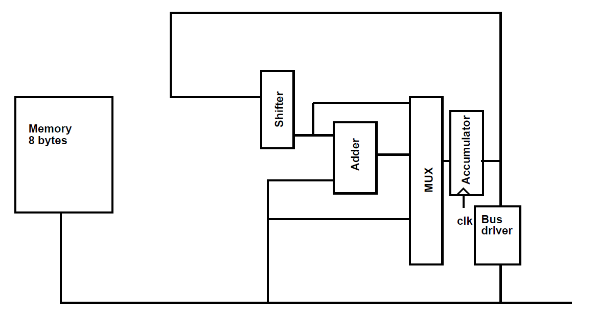
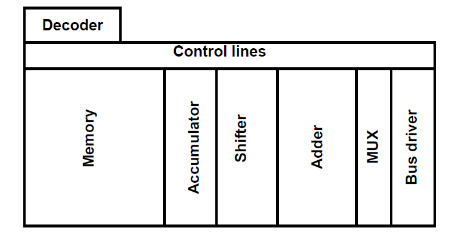
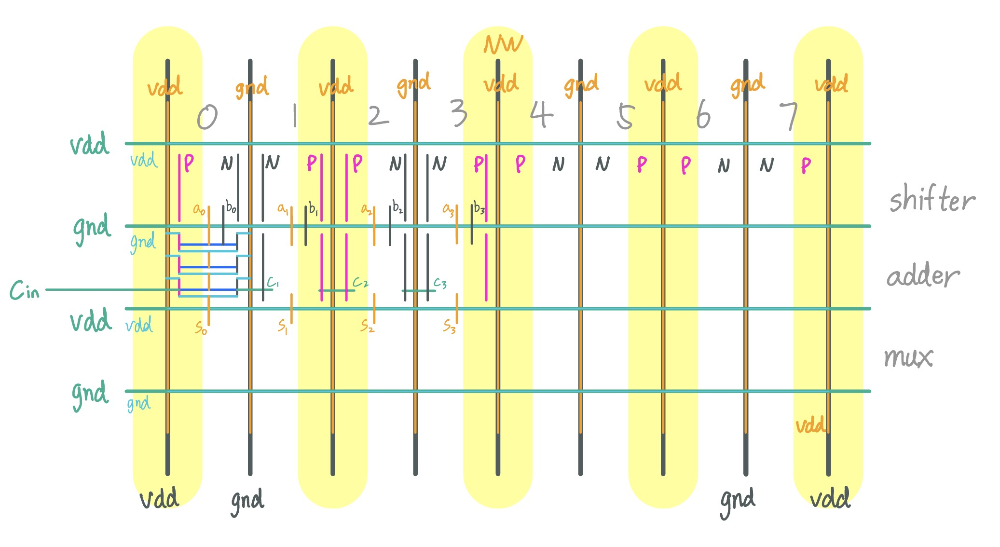





---

# Architecture

> Before even starting the project, read through the requirements so you know what you *should* be doing.
{: .notice--info}

Our microprocessor consists of:
- **Internal Bus**: single writer, multiple readers
- **Accumulator** (Acc): A flip-flop holding temporary values
- **Arithmetic**: adder, shifter
- **SRAM**

{: .align-center}

## Bus
The block diagram above has two critical nets: the *internal bus*, and the *accumulator*. 
- The **accumulator** (top net) is a flip-flop holding temporary values from the adder and shifter. Think of it as a register
- The **internal bus** (bottom net) routes the values to the components. 
	- Only one source below can drive the internal bus:
		- Accumulator
		- SRAM
		- External bus (not shown, for testing)  
	- All components below may read from the internal bus simultaneously:
		- Adder
		- Accumulator (via MUX)
		- SRAM
		- External bus

> Tristate buffers control data routing between SRAM/internal/external bus, preventing contention.
{: .notice--info}

---

# ISA
Try to derive what to do, combining with the data path above:

When **holding**, the value in Acc must not change. The MUX should select the shifter path, but **bypass** it, effectively feeding Acc back to itself

| Opcode | Assembly | Description                 | Internal bus driven by | MUX | Other Actions | 
|--------|----------|-----------------------------| ------ | ---- | --- | 
| 000    | NOP      | Hold Acc    | -- | Hold | No change
| 001    | LOAD     | Mem[i] ← External bus       |external bus| Hold |  Memory write
| 010    | STORE    | External bus ← Mem[i]      | SRAM | Hold | Memory read; Drive external bus
| 011    | GET      | Acc ← Mem[i]               | SRAM | Memory | Memory read
| 100    | PUT      | Mem[i] ← Acc               | Acc | Hold | Memory write
| 101    | ADD      | Acc ← Acc + Mem[i]         | SRAM | Adder | Memory read; Bypass shifter
| 110    | SUB      | Acc ← Acc - Mem[i]         | SRAM | Adder | Memory read; Bypass shifter
| 111    | SHIFT    | Acc ← Acc << shamt  | -- | Shifter | Don't bypass

> Yes, this ISA is terrible for logic simplification.  
And yes, there are obvious optimizations.

---

# Floorplan

> Floorplan! Floorplan! Floorplan! Many layouts don't suck at the end, they suck at the **beginning**! A bad initial decision will make you either **REDO** from scratch, or make **WORSE** and **WORSE** compromises to accommodate that
{: .notice--danger}

Here is the suggested floorplan from PS9

{: .align-center}

We have laid out an inverter already. The processor can be seen as many inverter-like gates neatly coordinated.

These are the 3 main things to plan:
- Data
- Control
- Power

## Metal Routing
> This is Shepard's suggested floorplan, **rotated 90 degrees**. I will stick with this orientation **from now on**
{: .notice--info}

Adopt consistent Metal routing rules. Let's make
- **Odd** Metal layers horizontal
- **Even** Metal layers vertical.
- There can be local violations, especially at lower levels

## Vertical Grid
Our 8-bit processor is built from isomorphic 1-bit slices placed side by side. We can create a **vertical** grid of M2 power rails of alternating VDD and GND
- Each cell will build VDD (PMOS N-Well) on one side, and GND (NMOS P-Well) on the other
- The power straps (body Vias) can be placed directly below the M2 rails
- All transistors will fit horizontally within each stripe. Larger transistors can be made of multiple **fingers**

See example in our [adder](/articles/vlsi/adder#7-po-connections-and-contacts)

> Although not done in our project, you can further design all blocks to have the **same height** to have an organized horizontal grid
- This leads to standard cells. You can check out the cells in the TSMC library!
- You can reference textbook chapter 1.10.2-4 (pages 48-51) on how an 8-bit MIPS processor is laid out
{: .notice--info}

## Bit Slice Width
You'll see me keep bringing up the **2.1 um** bit slice width later on. Here's why.

In PS8 you'll be given an SRAM macro. A natural choice is a 2-to-1 [column MUX](https://mg-04.github.io/articles/vlsi/sram#floorplan), which means each bit of your datapath sits under **two** SRAM columns. In **Fall 2025**, two columns of the given macro was 2.1 um. Match that, and your datapath lines up with the SRAM bit for bit. That's the whole argument.
- The macro is not likely to change from year to year, but **confirm it with Shepard** before you commit. Your bit pitch depends on it, and you don't want to realize it at PS8.

Other options also exist exist:
- **Squeeze each bit into *one* SRAM column.** I've seen teams doing that, but the SRAM is engineered to be dense and comes with its own special DRC rules. Matching that density with your own logic can be quite challenging.
- **Use a different pitch** for the datapath and connect the wires at the SRAM boundary. Totally valid, but route those connections **above** instead of around Don't bend them all over M1/M2 and leave a **massive gap** between your transistors. It looks disgusting, and it costs you area.


