

  <strong>Authors:</strong> {{ page.authors | join: ", " }}



Here's a picture page, just for fun





---

# Overall Layout

## 1x  
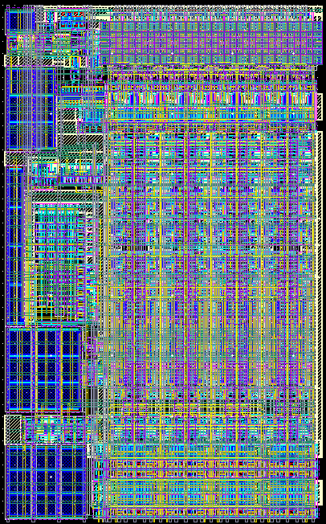

## 2x  
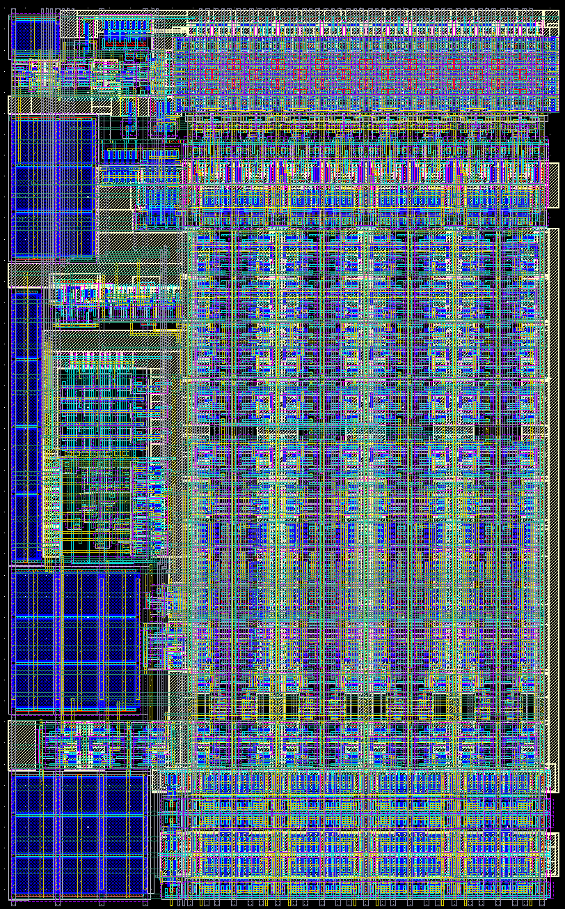

## 4x  
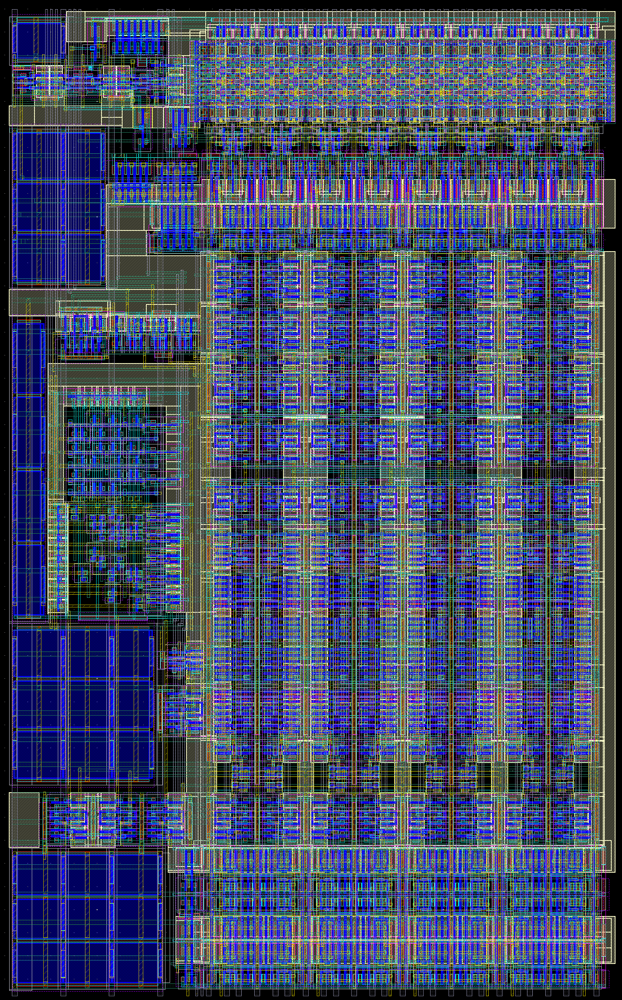{: .blurred}

## 8x  
{: .blurred}

## 16x  
{: .blurred}

---

# Various Layers

## OD-CO-PO  
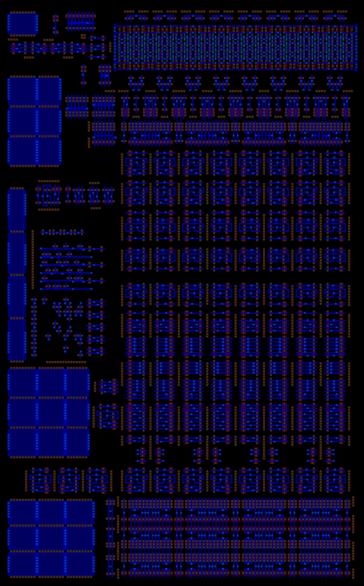{: .blurred}

## PO-CO-M1  
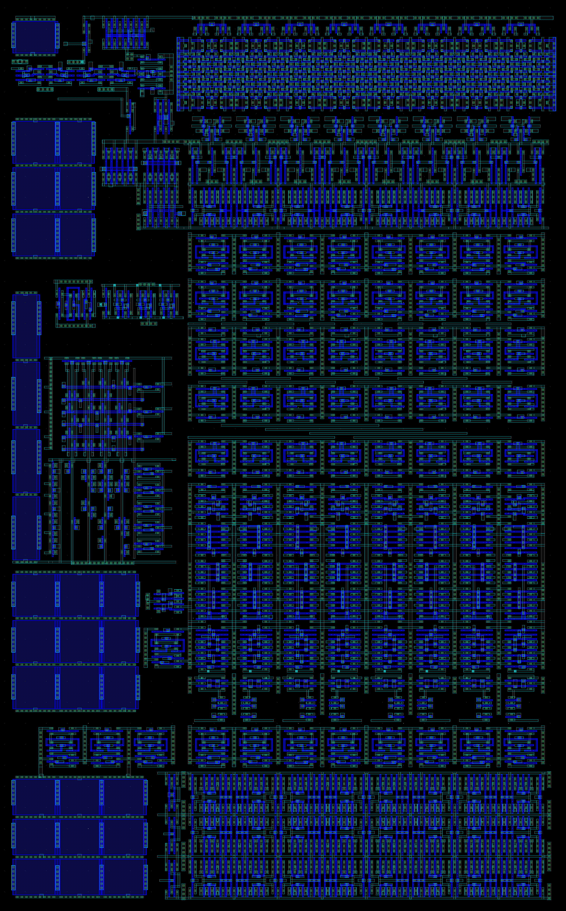{: .blurred}

## M1-VIA1-M2  
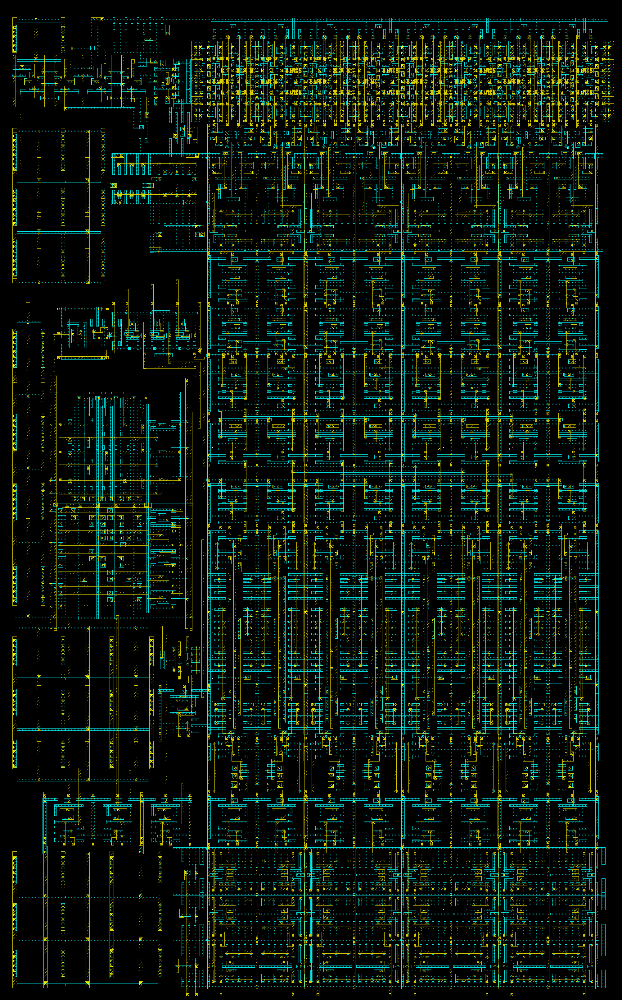{: .blurred}

## M2-VIA2-M3  
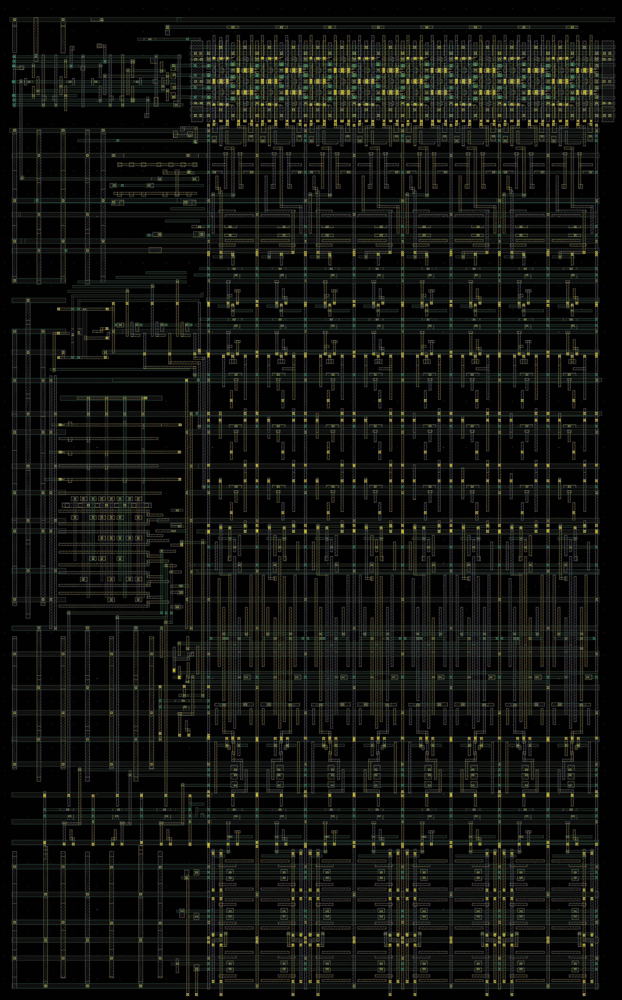

## M3-VIA3-M4  
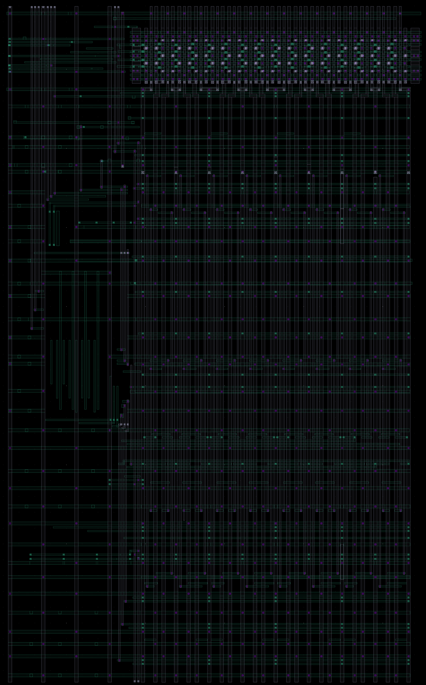

---

# Manhattan Sunrise
Nothing can be more rewarding than watching the Manhattan **sunrise**! Walking out DRC clean, LVS clean; sleep? not quite.

  <a class="image-popup" href="/images/vlsi/manhattan/skyline-dawn.jpg">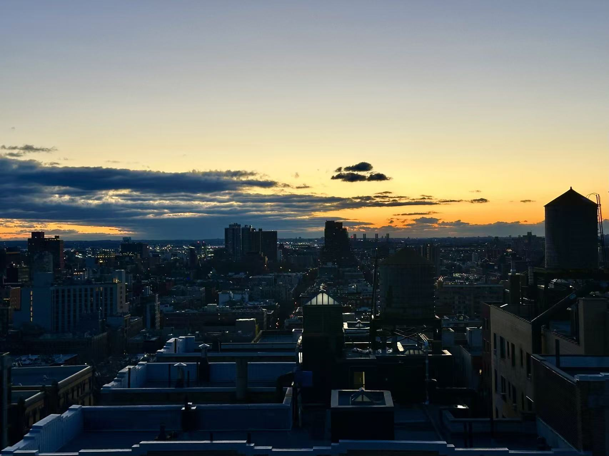</a>
  <a class="image-popup" href="/images/vlsi/manhattan/broadway-dawn.jpg">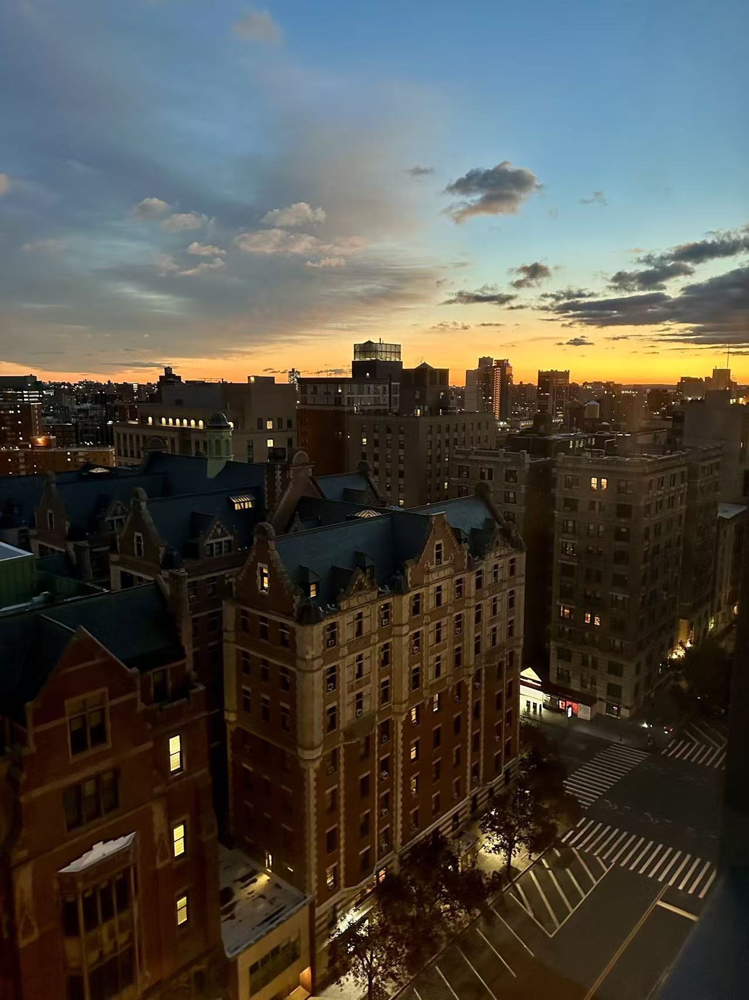</a>
  <a class="image-popup" href="/images/vlsi/manhattan/golden-clouds.jpg">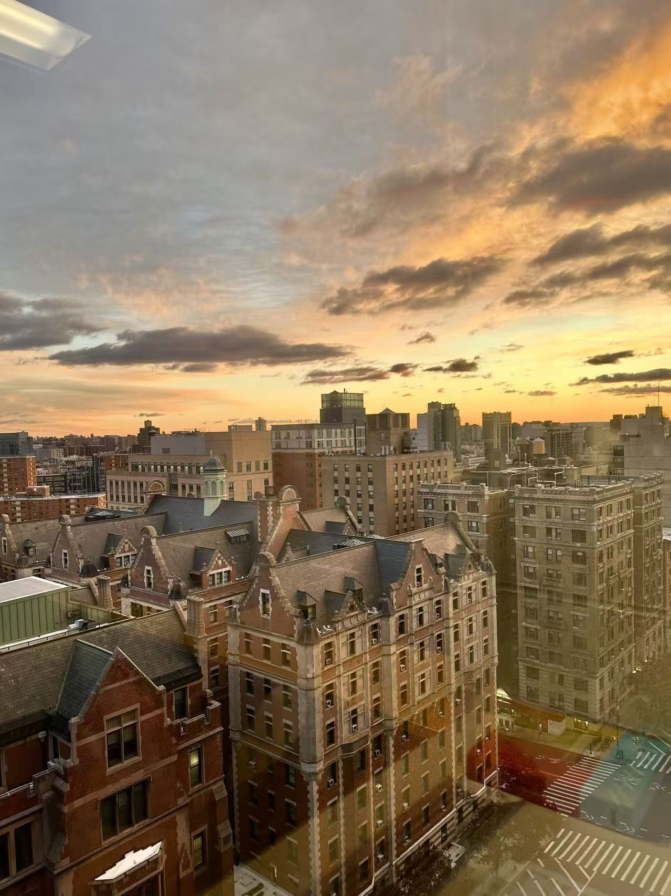</a>
  
  <a class="image-popup" href="/images/vlsi/manhattan/window-grid.jpg">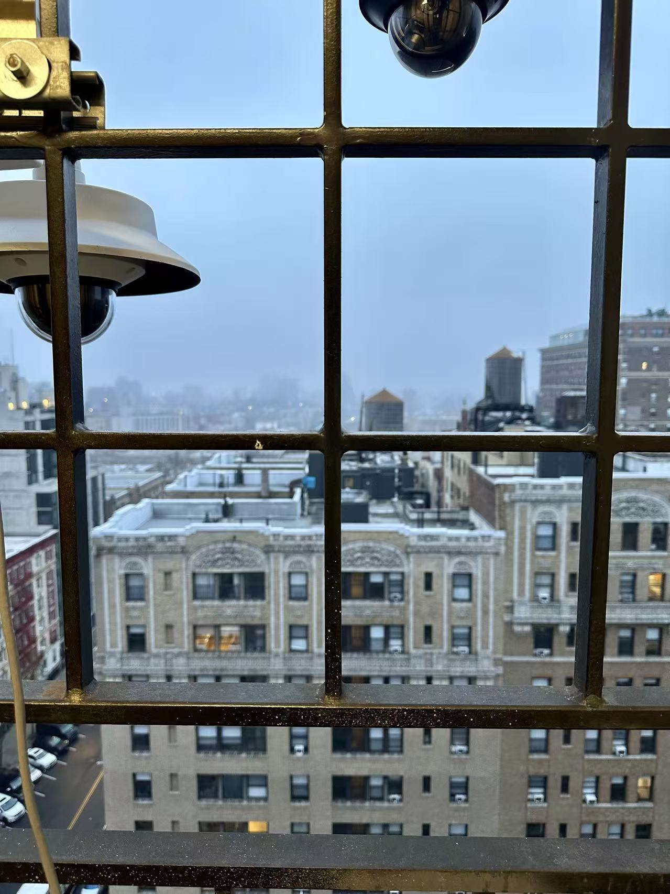</a>
  <a class="image-popup" href="/images/vlsi/manhattan/lab-reflection.jpg">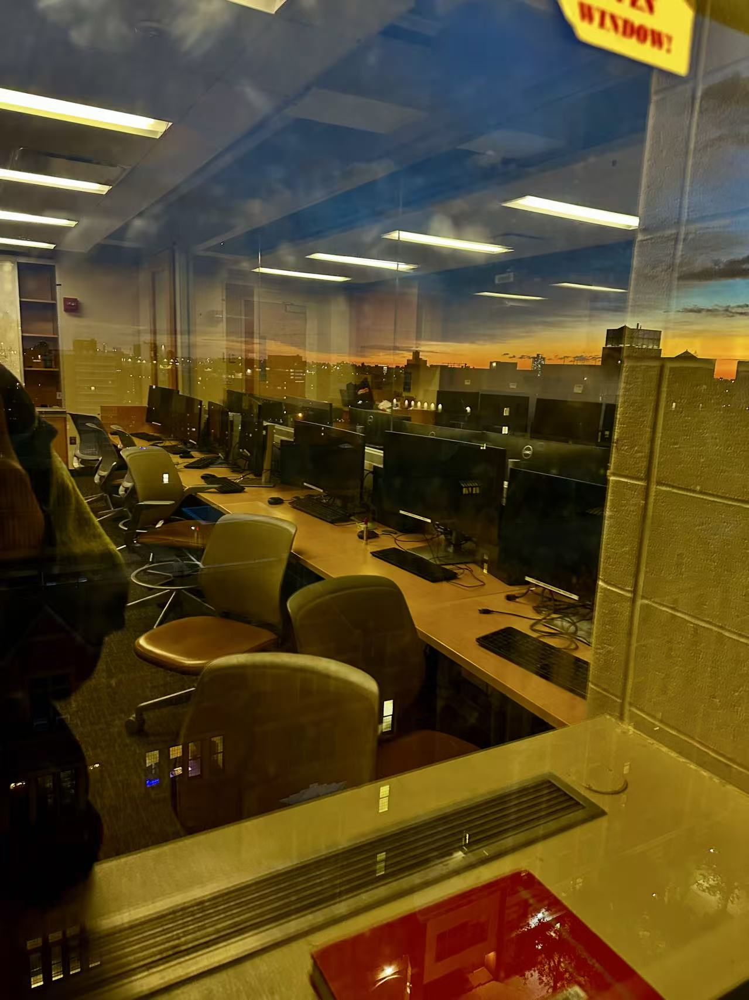</a>


