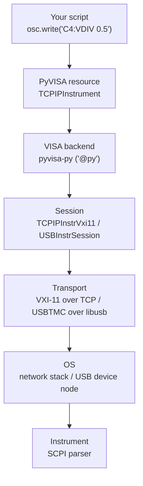
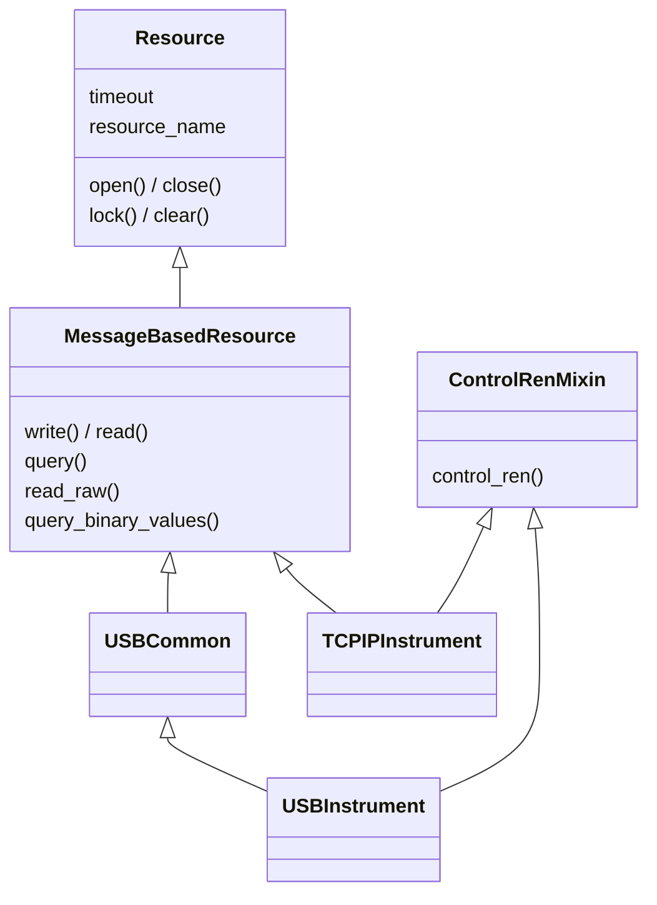



> Code: [mg-04/PyVISA_bench](https://github.com/mg-04/PyVISA_bench). Scripts for the scopes, function generator, and power supplies on our bench, controlled from a PYNQ board
{: .notice--info}

This line sets channel 4 of a Siglent SDS1104X-E scope to 500 mV/div:

```python
osc.write('C4:VDIV 0.5')
```

It looks like one function call, but it passes through about six layers before the scope's front panel changes. Knowing them makes debugging much easier: every "it can't find my instrument" error lives in exactly one of them.



---
# 1. The Command: SCPI
At the top and bottom of the stack is plain text. Instruments speak **SCPI** (Standard Commands for Programmable Instruments): you send a string, and a query (ending in `?`) sends a string back.

- **Common commands** work on almost anything: `*IDN?` (who are you), `*RST` (reset)
- **Vendor commands** don't. `C4:VDIV 0.5` and `C4:PAVA? FREQ` are Siglent's dialect; a Keysight scope spells the same idea differently

So everything below this layer is just a pipe that delivers strings. The scope does all the interpreting.

---
# 2. The Resource: PyVISA's Class Hierarchy
```python
import pyvisa
rm  = pyvisa.ResourceManager('@py')
osc = rm.open_resource('TCPIP::172.24.58.184::INSTR')
```

The resource string decides which class `open_resource()` returns. `TCPIP::…::INSTR` gives a **`TCPIPInstrument`**; the same scope plugged in over USB (`USB0::…::INSTR`) gives a **`USBInstrument`**:



Reading the MRO from the bottom up:

| Class | What it adds |
|---|---|
| `Resource` | Anything VISA can open: `open()`, `close()`, `timeout`, locking, the resource name |
| `MessageBasedResource` | Instruments that talk in **text**: `write()`, `read()`, `query()`, and `read_raw()` for binary blocks |
| `USBCommon` | USB-only attributes (vendor/product ID, serial number) |
| `ControlRenMixin` | `control_ren()`: switch the instrument between remote and front-panel control |
| `TCPIPInstrument` / `USBInstrument` | The concrete classes you actually get back |

The useful consequence: **my scope scripts never mention TCP or USB**. `write()` and `query()` live in `MessageBasedResource`, so swapping the resource string from `TCPIP::…` to `USB0::…` is the only change needed.

> `query()` is literally `write()` followed by `read()`, with an optional delay in between. Nothing magic.
{: .notice--info}

### Binary waveforms
Scalar answers are text, but waveforms are not. `C4:WF? DAT2` returns an IEEE 488.2 **definite-length block**: `#`, one digit *n*, then *n* digits giving the byte count, then raw `int8` ADC samples. That's why waveform capture uses `read_raw()` and parses the header by hand:

```python
osc.write('C4:WF? DAT2')
raw = osc.read_raw()
h = raw.find(b'#')
n = int(raw[h + 1:h + 2])                 # number of length digits
length = int(raw[h + 2:h + 2 + n])        # payload size in bytes
adc = np.frombuffer(raw[h + 2 + n:h + 2 + n + length], dtype=np.int8)
volts = adc * (vdiv / 25.0) - offset      # 25 ADC codes per division
```

---
# 3. The Backend: `'@py'`
`ResourceManager('@py')` picks the **VISA library** that does the real work. PyVISA itself is only a front end:

- **`'@ivi'`** (the default): a vendor VISA such as NI-VISA or Keysight IO Libraries, a large native install
- **`'@py'`**: **pyvisa-py**, a pure-Python implementation (`PyVisaLibrary`, a subclass of `VisaLibraryBase`)

On an ARM board like the PYNQ, vendor VISA isn't really an option, so pyvisa-py it is. That choice decides everything below.

---
# 4. The Session
Inside pyvisa-py, each resource is backed by a **session** object chosen from the resource string. These form their own small hierarchy:

```
Session
├── TCPIPInstrSession   (dispatcher)
│     ├─> TCPIPInstrVxi11    default
│     └─> TCPIPInstrHiSLIP   if the name starts with "hislip"
├── TCPIPSocketSession  (raw ::SOCKET, port 5025)
└── USBSession
      ├── USBInstrSession   (USBTMC instruments)
      └── USBRawSession
```

`TCPIPInstrSession` is not a real session: its `__new__` looks at the resource name and returns a VXI-11 or HiSLIP session instead. Our scope's `TCPIP::172.24.58.184::INSTR` has no `hislip` in it, so it gets **VXI-11**.

---
# 5. The Transport
- **VXI-11** (TCP/IP): an RPC protocol from the GPIB-over-Ethernet era. pyvisa-py implements its RPC client in Python, so the only requirement is that the board can reach the scope's IP
- **USBTMC** (USB): the USB Test & Measurement Class, a standard way of wrapping SCPI strings in USB packets. pyvisa-py drives it through **pyusb → libusb**, talking to the raw USB device directly instead of through a kernel driver

---
# 6. The OS: Where USB Breaks
TCP just works once the network does. USB is where our bench actually got stuck: the instruments showed up in `lsusb`, but PyVISA couldn't open them. Here's one of our USB power supplies:

> Since pyvisa-py talks to the raw device node, your user needs **read/write** access to it. By default, Linux grants that only to `root`.
{: .notice--warning}

```shell
$ lsusb
Bus 001 Device 015: ID 2a8d:8f01 Keysight Technologies, Inc. EDU36311A
$ ls -l /dev/bus/usb/001/015
crw-rw-r-- 1 root root 189, 14 ...    # others: read-only
```

The fix is a udev rule granting access by vendor/product ID, in `/etc/udev/rules.d/99-usbtmc.rules`:

```
SUBSYSTEM=="usb", ATTRS{idVendor}=="2a8d", ATTRS{idProduct}=="8f01", MODE="0666"
```

```shell
sudo udevadm control --reload-rules
sudo udevadm trigger
# then physically unplug and replug the instrument
```

After replugging, the node becomes `crw-rw-rw-` and the instrument appears in `rm.list_resources()`.

- PyVISA prints vendor/product IDs in **decimal**: `2a8d` shows up as `10893` in `USB0::10893::36609::…::INSTR`
- The `lsusb -v` interface class should read `254 / 3 / 1`: Application Specific, Test and Measurement, TMC. If not, it isn't a USBTMC device

---
# Debugging by Layer
Each symptom points at one layer:

| Symptom | Layer | Check |
|---|---|---|
| Not in `lsusb` | Physical | Cable, port, power |
| In `lsusb`, not in `list_resources()` | OS | udev permissions (above) |
| Opens, but `*IDN?` times out | Transport | IP reachable? VXI-11 vs `::SOCKET`? |
| `*IDN?` works, other commands don't | SCPI | Vendor dialect: check the programming manual |
| Values parse wrong | Your script | Units in the reply, e.g. `C4:PAVA FREQ,500.0Hz` |

A one-liner that walks every layer at once:

```python
for res in rm.list_resources():
    try:
        inst = rm.open_resource(res)
        print(res, '->', inst.query('*IDN?').strip())
    except Exception as e:
        print(res, '-> Error:', e)
```
