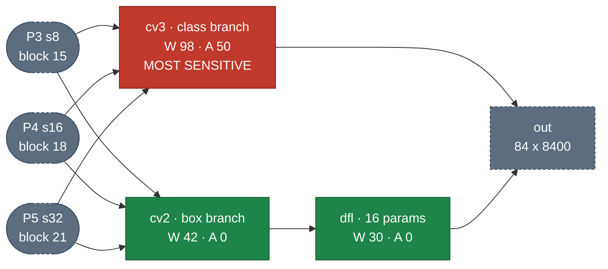

> Work in progress. More details to come!  
> Code and full results: [mg-04/yolov8-project](https://github.com/mg-04/yolov8-project)
{: .notice--info}

A PyTorch fault-injection framework for **YOLOv8n**, used to find which weights and layers need protection in a secure-FPGA + Jetson deployment. It flips single bits in FP32 **weights** (memory faults) and **activations** (buffer and compute faults), then separates **silent** corruption from **detectable** corruption.

---
# Method
- **Target**: YOLOv8n after BatchNorm fusion, 64 conv layers, ~3.1M parameters, evaluated on COCO
- **Fault sites**: weights, persistent activation faults, and transient (single-inference) activation faults
- **Campaign**: 64 layers × 16 targets × 6 bit positions × 3 sites = **18,432 injections**
- **Outcomes** per image:
	- **DUE**: NaN/Inf in the output, detectable at runtime
	- **SDC**: clean-looking output with lost, phantom, or misclassified objects, *not* detectable
	- **Benign / masked**: detections unchanged or only slightly shifted

---
# Key Findings
- **One bit carries the risk.** Bit 30, the FP32 exponent MSB, accounts for ~93% of random-fault risk. Flipping it scales a typical weight by $$2^{128}$$
- **Weight faults are silent; activation faults are loud.** At bit 30, weight faults are 83% SDC and 6% DUE, while activation faults are 23% SDC and 31% DUE
- **Every other bit is undetectable.** NaN/Inf appears only at bit 30, so faults at other bits never show up in the output
- **The classification head is the most sensitive part of the network** under every fault type

---
# Detect Head
Three scales, two branches. Numbers are the per-image SDC rate under a bit-30 fault: `W` = weight fault, `A` = persistent activation fault. Red = most sensitive, green = least.

The class branch (`cv3`) and the box branch (`cv2`) see the same inputs at the same depth, yet have opposite sensitivity. A corrupted class score poisons the NMS ranking for the whole image, while a corrupted box coordinate only misplaces one detection.
